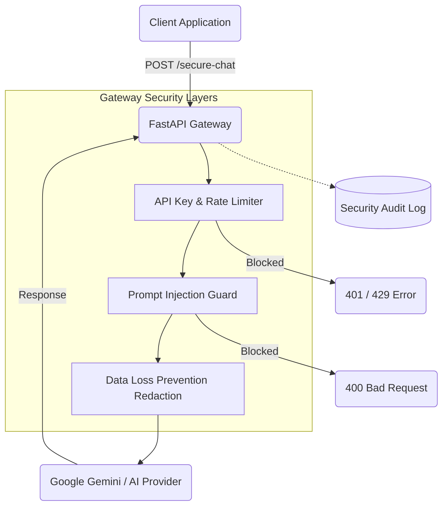

# Secure LLM Gateway

This project is a secure middleware built with Python and FastAPI. It sits between your application and a Large Language Model (like Google Gemini or OpenAI) to protect sensitive data and prevent malicious interactions.

## Architecture

The gateway intercepts incoming requests, verifies identity, checks for malicious prompt injections, and redacts sensitive data before passing the prompt to the AI provider.



## Features

- **Data Redaction:** Automatically detects and replaces emails, credit cards, and API keys with safe placeholders before they reach the AI.
- **Injection Protection:** Blocks jailbreak attempts and system prompt leaks using pattern recognition.
- **Access Control:** Requires a valid API key and enforces a strict rate limit of 10 requests per minute per IP address.
- **Audit Logging:** Keeps a structured JSON log of all security events without recording sensitive user data.
- **Container Ready:** Includes a multi-stage Dockerfile designed to run without root privileges.
- **Automated Security:** Uses GitHub Actions to run unit tests, Python static analysis (Bandit), and container vulnerability scans (Trivy).

## Setup Instructions

### 1. Installation

Clone this repository and install the required dependencies:

```bash
pip install -r requirements.txt
```

### 2. Configuration

Create a `.env` file in the root directory and add your AI provider API key along with your custom gateway key:

```env
GEMINI_API_KEY=your_google_api_key_here
API_KEY=default-dev-key
```

### 3. Running the Gateway

Start the application locally using Uvicorn:

```bash
uvicorn main:app --reload
```

The gateway will be available at `http://127.0.0.1:8000`. 

### 4. Testing

Run the automated test suite using Pytest:

```bash
pytest
```

## Usage Example

Send a POST request to `/secure-chat` using your custom API key:

```bash
curl -X POST "http://127.0.0.1:8000/secure-chat" \
     -H "X-API-Key: default-dev-key" \
     -H "Content-Type: application/json" \
     -d '{"user_prompt": "Hello, my email is user@example.com."}'
```
